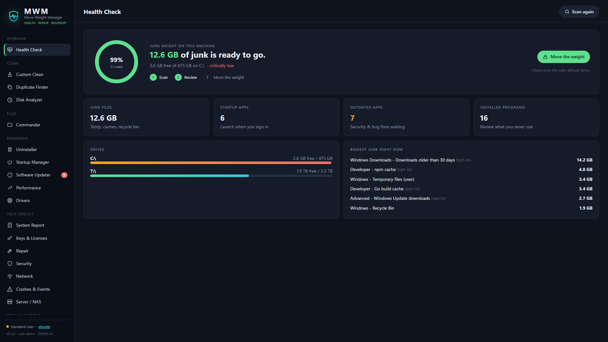

<p align="center"></p>
<h1 align="center">MWM — Move Weight Manager</h1>
<p align="center"><b>Your whole fleet — PCs, servers, Proxmox clusters, hosting panels — from one app.</b><br>
Desktop (Windows / Linux / macOS) · Browser UI on any server · Bootable Rescue ISOs · Android · CLI.<br>
Free and open source. No ads, no "Pro" tier, no telemetry.</p>

<p align="center"><a href="https://manage.moveweight.com/">Website</a> · <a href="https://github.com/BlizzHacker/mwm/releases/latest">Download</a> · <a href="https://manage.moveweight.com/app/">Private web manager</a></p>

<p align="center"></p>

MWM replaces the pile of tools a PC tech and a homelab admin carry — cleaner, uninstaller, file manager,
Geek Squad MRI / Hiren's repair kit, CPU-Z, HWMonitor, SDelete, Proxmox web UI extras, hosting panel tools —
with **one Rust core** that every surface shares:

| Surface | What you get |
|---|---|
| 🖥️ **Desktop app** | Native Tauri app for Windows, Linux (AppImage/.deb) and macOS (.dmg) |
| 🌐 **`mwm serve`** | The full UI in any browser from one static binary — for Proxmox, Unraid, any headless Linux |
| 💿 **MWM-Rescue-WinPE.iso** | WinPE 11 rescue disc (BIOS+EFI): boots to a rescue menu, serves the whole MWM web UI on your LAN, bundles TestDisk/PhotoRec, Sysinternals, PuTTY, Memtest86+, 7-Zip, Notepad++ |
| 🐧 **MWM-Rescue-Linux.iso** | Debian live rescue (BIOS+EFI): TestDisk, chntpw, smartmontools, gddrescue, mdadm/LVM/cryptsetup, stress-ng, ipmitool — MWM rescue server auto-starts on boot |
| 📱 **Android** | Signed APK + AAB (Play-ready), built by CI on every release |
| ⌨️ **CLI** | Every function scriptable: `mwm clean`, `mwm server`, `mwm repair sfc`, … |

Every surface calls the **same command table** (`crates/mwm-core/src/api.rs`), so desktop, web, rescue disc
and mobile have feature parity by construction — there is no second codebase to drift.

---

## What it does

### Infrastructure (Proxmox / servers / hosting)

| Area | MWM |
|---|---|
| **Command Center** | One live view of your whole estate: every node, LXC/VM, app, service endpoint, Traefik route and hosting domain, with search. Create LXCs from templates with live resource validation. |
| **Proxmox cluster** | Guests on every node: start / shut down / reboot / force-stop, snapshots, backups, live migration, task logs streamed as jobs. Cluster status, storage, HA, last-backup coverage. |
| **HestiaCP hosting** | Live management (not scraped): every user and web domain with SSL / Let's Encrypt / suspended state; per-domain suspend, unsuspend, rebuild configs, issue certificates; DNS record add/delete. |
| **LXC files & updates** | Agentless file manager *inside* any LXC (browse, read, write, mkdir, delete). Package-update inventory across all running LXCs on all nodes — no agent inside guests. |
| **Docker in LXCs** | Cluster-wide discovery of which LXCs run Docker; per-container start/stop/restart/remove, image/container/builder/network prune, disk reclaim; Compose project image updates. |
| **Cluster update policies** | PVE host updates, LXC package updates and Docker image updates on systemd timers, each **opt-in per target**, snapshot-gated, backup-gated, one target per run, never auto-reboots. |
| **Machines (fleet)** | Add every MWM install (Proxmox nodes, Unraid, Linux boxes, other PCs) as a connection; the whole UI then drives that machine through the sidebar switcher — health, files, repairs, cluster pages, everything. |
| **Server / NAS dashboard** | ZFS pools + scrub, SMART for every disk, failed services, kernels, Unraid array, Proxmox task logs. |
| **Service plugins** | Discovers ARR stack (Sonarr/Radarr/Lidarr/Prowlarr), qBittorrent, Jellyfin, Plex, RomM, NZBGet, Seerr, Tautulli, Komga, FlareSolverr across connected nodes — version, health, queue depth. Optional MCP-ARR bridge. |

### Rescue & diagnostics (the Geek Squad MRI replacement)

| Area | MWM |
|---|---|
| **Rescue Center** | The 2026 MRI replacement. A catalog of every MRI tool mapped to its modern equivalent: built into MWM, bundled open-source in the rescue ISOs, or fetched from the vendor's official URL on demand (McAfee Stinger, Norton Power Eraser, KVRT, AdwCleaner, Sysinternals…) — always current, always legal, checksum-verified. |
| **File Integrity (FMOD replacement)** | Hash baseline of your system directories (System32, /usr/bin, /sbin, LaunchDaemons…), then drift scans reporting every **changed / vanished / added** file as a streamed job. Cross-platform. Complements `sfc /scannow`. |
| **Hardware (CPU-Z / GPU-Z replacement)** | CPU model/topology/clocks/load, GPU list with VRAM, temps, utilization, clocks, power (nvidia-smi + sysfs amdgpu + WMI), thermal zones, hwmon sensors and fans, per-stick RAM from DMI, board/BIOS. Live re-read button. Real values only — never faked. |
| **Malware Lab** | Offline static triage of any file: entropy, sections, imports, IOC extraction (URLs, IPs, registry, commands), malware-family heuristics, risk score; ClamAV scan when installed; quarantine with restore. Optional Arkana (your own instance) deep analysis. |
| **Repair toolkit** | SFC, DISM RestoreHealth + component cleanup, chkdsk, Windows Update reset, restore point, clock resync, icon cache, DNS flush, IP renew, Winsock/TCP-IP reset, spooler fix, Defender update/quick/full scan, battery + energy reports, memory test. Linux: fix broken packages, old-kernel removal, Docker cleanup, ZFS scrub, SMART self-tests, journal vacuum. Live output; jobs keep running across pages. |
| **Keys & Licenses** | Windows key (firmware + registry-decoded), Office keys, **BitLocker recovery keys**, saved Wi-Fi passwords, SSH host keys, Proxmox subscription, Unraid license. Show / copy / export. |

### PC management

| Area | MWM |
|---|---|
| **Move Weight** | The namesake: moves heavy folders off your system drive onto **your own server** and keeps them off. Git repos ship only what no remote has (unpushed commits/stashes bundle, uncommitted diff, untracked + ignored-but-unique files); rebuildables (`node_modules`, `target`, `dist`) are dropped and re-cloned when needed. Other folders travel as gzip tars. Every shipment is SHA-256 verified server-side before anything local is deleted; a ledger + RESTORE.md per shipment. The **guard** (scheduled) moves folders idle for N days. |
| **Health Check** | Junk, startup, outdated apps and disk at a glance; one click cleans only the safe defaults. |
| **Custom Clean** | 40+ rules: temp, recycle bin, thumbnails, crash dumps, WER, Update cache, Store apps, NVIDIA/Discord/VS Code/Steam caches, dev caches, every Chromium browser + Firefox. Linux: apt/dnf cache, journals, rotated logs, /tmp, Proxmox task logs. |
| **Uninstaller** | Runs the real uninstaller (UAC-aware), then hunts leftover folders/shortcuts/registry keys → Recycle Bin; registry exported to `.reg` first. Store apps, dpkg/flatpak/snap on Linux. |
| **Commander** | Dual-pane keyboard-first file manager: F3 view (text/image/hex), F5 copy, F6 move, F7 mkdir, F8 recycle, Alt+F7 search, multi-rename, zip pack/unpack, folder sizes, compare panes, full right-click menus. Background jobs with progress/cancel/conflict handling. |
| **File Explorer takeover** | One toggle makes double-clicking any Windows folder or drive open **MWM Commander** instead of Explorer (HKCU only, no admin, fully reversible). Second launches forward the folder to the running instance. |
| **Vault** | Open/edit/save KeePassXC-compatible KDBX3/4 in desktop *and* browser: groups, history, attachments, key files, TOTP, generator, search, encrypted backups, browser-CSV import (Google/Brave/Edge), machine-key import. Master password never leaves the UI process; agents store encrypted KDBX bytes only. |
| **Also** | Startup Manager (Task Manager-compatible toggles), Software Updater (winget/apt/brew), Duplicate Finder (BLAKE3), Disk Analyzer, Performance, Drivers inventory, Shredder + free-space wipe, System Report (exportable HTML), Security center, Network doctor, Crashes & Events, System Tools launcher. |

---

## Install

### Windows 10 / 11
1. Download `MWM-portable.exe` (or the MSI installer / Store MSIX) from
   [**Releases**](https://github.com/BlizzHacker/mwm/releases/latest) — verify against `MWM-portable.exe.sha256`.
2. Run it. That's the whole install (portable).
3. *Optional — auto-update:* run `deploy/updates/install-windows.ps1` to register a current-user Task
   Scheduler job. It checks the latest GitHub release daily, verifies SHA-256 + version, stages the update
   and swaps it when MWM is closed, keeping the previous exe for rollback.
4. *Optional — Defender note:* Windows SmartScreen/Defender occasionally false-positives on unsigned
   portable Rust exes. Every release passes a CI Defender-scan gate; add an exclusion for the install
   folder if your AV quarantines it.

### Proxmox VE / Debian / Ubuntu / Unraid (any x86_64 Linux)
```sh
curl -fsSL https://github.com/BlizzHacker/mwm/releases/latest/download/install.sh | sh -s -- --web
```
Then open the printed link: `http://<server>:7777/?token=***
- `--read-only` → look-don't-touch dashboard (all mutating commands refused)
- `--bind 127.0.0.1:7777` → localhost only
- Prefer packages: `apt install ./MWM_x.y.z_amd64.deb`, or the Unraid plugin:
  *Plugins → Install Plugin* → `https://github.com/BlizzHacker/mwm/releases/latest/download/mwm.plg`

### Rescue ISOs (bootable USB)
1. Download `MWM-Rescue-WinPE.iso` and/or `MWM-Rescue-Linux.iso` from Releases (verify `.sha256`).
2. Write to USB: Rufus / `dd if=MWM-Rescue-Linux.iso of=/dev/sdX bs=4M status=progress`.
3. Boot the broken machine (both discs are BIOS **and** UEFI).
4. The disc serves the full MWM web UI at `http://<its-ip>:7777` (token printed on screen) — manage it
   from any other PC's browser — plus a direct rescue menu: TestDisk/PhotoRec, Memtest86+, chntpw,
   smartctl, the whole tool catalog.

### Android
Sideload `app-universal-release.apk` from Releases (AAB for Play submission is published alongside).

### macOS
Download `MWM_x.y.z_universal.dmg` from Releases (universal arm64 + x86_64).

---

## Manage multiple machines from one install

1. Install MWM with `--web` on each server (one-liner above).
2. On the managing machine: **Machines → ＋ Add machine** → paste the URL + token the server printed.
3. Use the sidebar **switcher** to drive any connected machine — every page (health, files, repairs,
   cluster, hosting) follows the selected target. Tokens are stored DPAPI-protected (Windows) / 0600.

## Scheduled updates (self-healing fleet)

Linux services check the latest stable GitHub release 4×/day, verify SHA-256 + version, keep the prior
binary, restart, and **roll back automatically on failure**:

```sh
sudo sh deploy/updates/install.sh --service mwm-web
# on ONE Proxmox node, add cluster-wide timers (LXC apt @03:30, PVE hosts @05:30, Docker @06:30):
sudo sh deploy/updates/install.sh --service mwm-web --cluster
sudo systemctl list-timers 'mwm-*'
```

Automatic guest/host upgrades start **off** everywhere; opt in per target from *Proxmox Cluster →
Updates* once backups are green (an enabled backup job on active storage is enforced, a snapshot is
taken before every upgrade, at most one target per run, no automatic reboots).

---

## Command line

```
mwm info                 machine, disks, elevation
mwm scan                 measure every cleaning rule (deletes nothing)
mwm clean [--ids a,b] --yes
mwm apps [filter]        installed programs      mwm uninstall <id> --yes
mwm startup [--set ID off]                       mwm updates [--apply all]
mwm keys                 keys & licenses         mwm report    hardware / license report
mwm server               Proxmox / ZFS / SMART / Docker
mwm repair --list        repair tasks            mwm repair sfc
mwm dupes <dir>          mwm analyze <dir>       mwm shred <file> --yes
mwm serve [--bind 0.0.0.0:7777] [--read-only]    full browser UI
mwm serve --show-token / --new-token
mwm offload [scan|guard|status]   Move Weight to your server
mwm --json <command>     machine-readable output
```

---

## Safety model

- **Nothing deletes without verification.** Move Weight removes a folder only after its shipment is
  SHA-256-verified server-side (tars recounted); failures keep the folder and report. Scans never delete;
  cleaning skips files in use.
- **Reversibility everywhere.** Uninstall leftovers → Recycle Bin, registry keys → `.reg` backups first.
  Startup toggles are Task Manager-compatible. Explorer takeover is HKCU-only, one toggle off.
  Integrity baselines are your own snapshots; repairs use only OS-shipped tools.
- **Server UI is authenticated + CSRF-safe.** Random token → HttpOnly, SameSite=Strict cookie; JSON-only
  API; `--read-only` refuses every mutating command (list enforced in code, not docs). Plain HTTP —
  keep it on your LAN or behind a VPN/reverse proxy.
- **Credentials stay put.** Hestia/ARR API keys are read inside their owning hosts and never returned to
  the UI. Vault master passwords never leave the UI process. Connection tokens are DPAPI/0600-protected.
- **Supply chain.** Rescue-catalog downloads come from vendor-official URLs, checksum-verified where
  pinned; releases are SHA-256'd and CI-Defender-scanned before publish.

## KeePassXC vault migration

Open **Vault** → **Import KeePassXC KDBX** → select your `.kdbx`, enter its master password/key file in
the app. MWM verifies decryption before saving the encrypted KDBX on the selected machine; your original
file is untouched. **Download KDBX backup** round-trips to KeePassXC. Bundled crypto: KdbxWeb (patched
XML parser) + hash-wasm Argon2; licenses included beside the scripts. After unlocking, **Import browser
CSV** accepts Google Password Manager / Brave / Edge exports (parsed in the WebView, never sent to an
agent; history-merged on repeat imports). Autofill/passkeys/Auto-Type are not implemented — keep
KeePassXC if you rely on them.

## MCP-ARR compatibility

MWM has native Proxmox service discovery and can also bridge [MCP-ARR](https://github.com/aplaceforallmystuff/mcp-arr).
On a node owning Sonarr/Radarr/Lidarr/Prowlarr: `sudo python3 deploy/arr/install.py` installs MCP-ARR on
`127.0.0.1:3000/mcp` (reads each service's API key from its LXC, root-only env file). **Plugins** page →
*Connect MCP-ARR* → *Browse tools*. Loopback endpoints only. Arkana-in-LXC: **Malware Lab → Connect
Arkana LXC** (reads its API key via `pct`, pushes samples via `pct push`).

## Build

```sh
# everything cross-compiles from Linux
rustup target add x86_64-pc-windows-msvc x86_64-unknown-linux-musl
cargo install cargo-xwin tauri-cli
cd app/src-tauri && cargo tauri build --runner cargo-xwin --target x86_64-pc-windows-msvc
cargo build --release --target x86_64-unknown-linux-musl -p mwm-cli
packaging/linux/build-packages.sh 5.5.0 dist/     # .deb, Unraid .plg, install.sh, SHA256SUMS
cargo tauri android build --apk --aab             # Android (NDK 27 + keystore.properties)
```
- Store MSIX (Windows + SDK): `packaging/msix/build-msix.ps1`
- Rescue ISOs: `iso/build-winpe-iso.cmd` (needs ADK + WinPE add-on, run elevated) and
  `iso/build-linux-iso.sh` (Debian live-build; stage the musl binary at `files/usr/local/bin/mwm`)
- Layout: `crates/mwm-core` (engine + the one command table), `crates/mwm-cli` (`mwm`, incl. `serve`),
  `app/src-tauri` (desktop/mobile shell: `lib.rs` has the `mobile_entry_point`), `app/ui` (plain
  HTML/JS shared by desktop, web, rescue and demo), `iso/` (rescue builders), `deploy/` (updaters, ARR)

## Release pipeline

Tag `vX.Y.Z` → GitHub Actions builds **desktop** (MSI/NSIS, MSIX, AppImage/.deb, universal .dmg),
**Android** (signed APK + AAB), **Linux musl CLI**, runs the Defender gate and a UI asset-parity test,
and publishes every artifact + SHA-256 sums to the release. Self-updaters on your fleet pick it up.

## Roadmap
1. **Windows** — desktop app, installer, MSIX. *Shipping; Store certification pending.*
2. **Linux / Proxmox / Unraid** — static CLI + browser UI + cluster dashboards. *Shipping.* Next: TrueNAS SCALE app.
3. **MWM Rescue** — WinPE + Linux rescue ISOs with the full tool catalog. *Shipping.*
4. **Android** — APK/AAB building in CI. *Shipping.* Next: storage insight / duplicate cleanup inside Android's rules.
5. **iOS / iPadOS** — storage insight and duplicate cleanup (Apple allows nothing more).
6. **macOS** — engine complete; needs signed/notarized builds.

## License
GPL-3.0-or-later. © 2026 MoveWeight Foundation. See [LICENSE](LICENSE) and [PRIVACY.md](PRIVACY.md).
